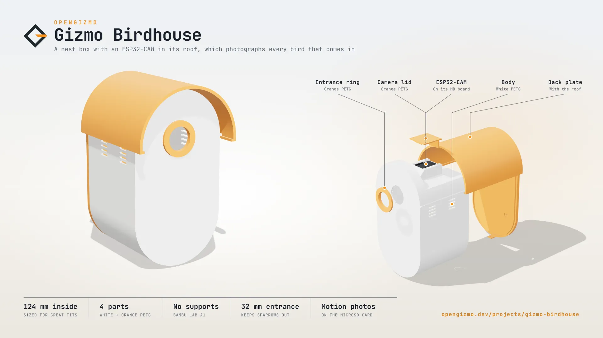
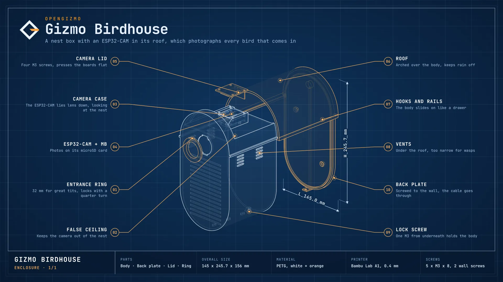
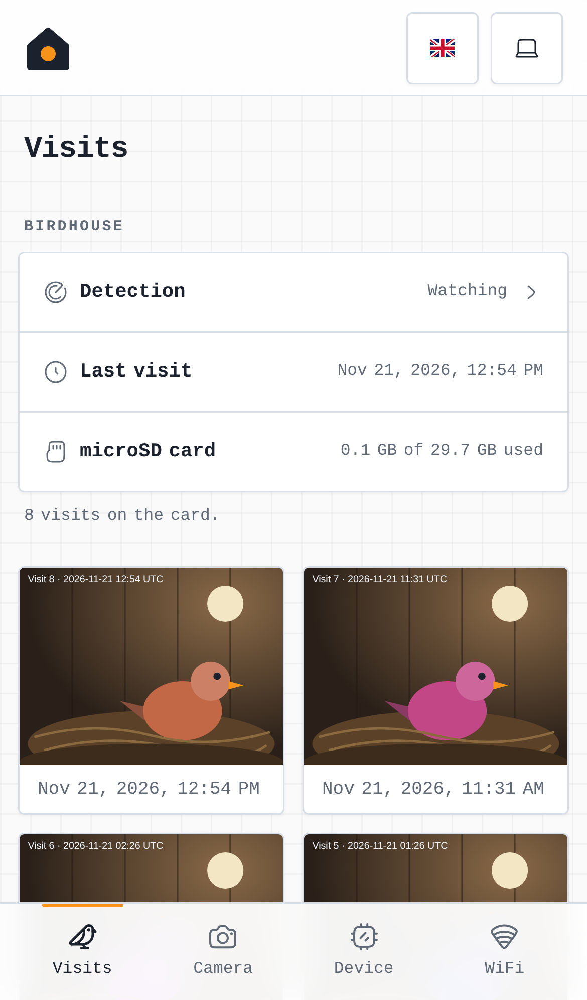
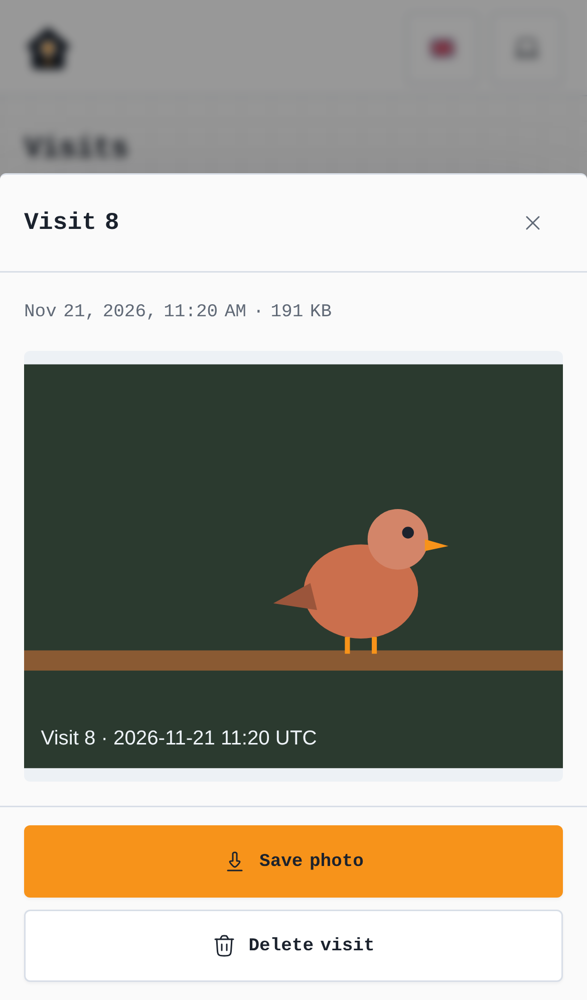
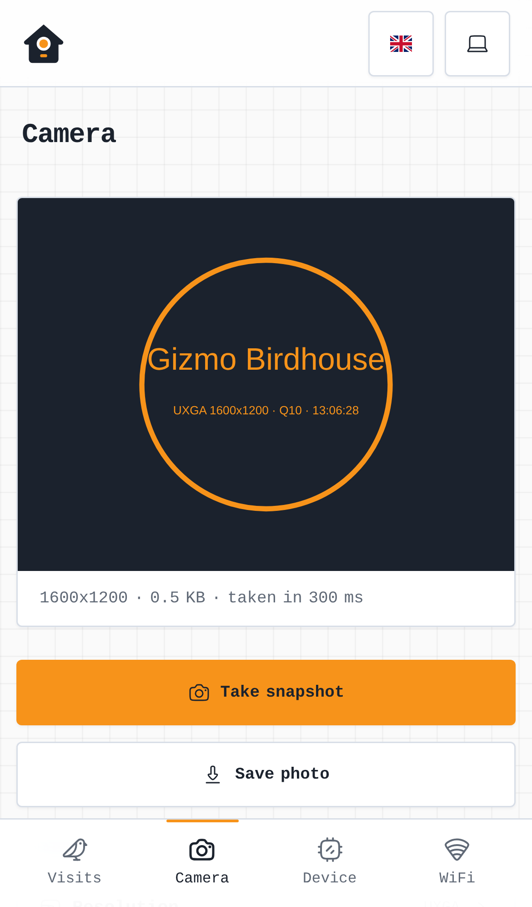
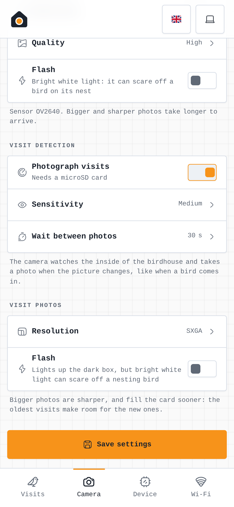
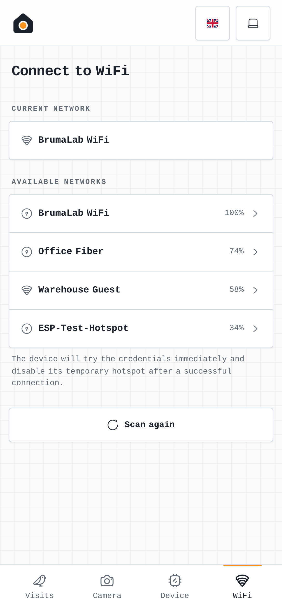

<div align="center">

# 🐦 Gizmo Birdhouse

### A smart birdhouse that photographs its visitors, with an ESP32-CAM

Gizmo Birdhouse is a two-part project that puts an AI Thinker ESP32-CAM inside a 3D-printed birdhouse: ESP32 firmware that notices when a bird comes in and saves its photo on a microSD card, and a Nuxt 4 web app, built into the firmware, to see the visits and set it up from your phone.

<p>
  <a href="https://opengizmo.dev/projects/gizmo-birdhouse"></a>
</p>

<p>
  <a href="https://github.com/open-gizmo/gizmo-birdhouse"></a>
  
  
  
  
</p>

<p>
  📡 Wi-Fi setup from the phone • 🐦 Visit detection with no extra wiring • 💾 Photos on the microSD card • 📸 Live snapshots • 🌐 Simple HTTP API • 🌍 EN/IT UI
</p>

<p>
	<a href="#enclosure"><strong>Enclosure</strong></a> •
	<a href="#overview"><strong>Overview</strong></a> •
	<a href="#images"><strong>Images</strong></a> •
	<a href="#features"><strong>Features</strong></a> •
	<a href="#architecture"><strong>Architecture</strong></a> •
	<a href="#quick-start"><strong>Quick Start</strong></a> •
	<a href="#hardware"><strong>Hardware</strong></a> •
	<a href="#firmware-overview"><strong>Firmware Overview</strong></a> •
	<a href="#configuration"><strong>Configuration</strong></a> •
	<a href="#troubleshooting"><strong>Troubleshooting</strong></a> •
	<a href="#license"><strong>License</strong></a>
</p>

</div>

<a id="enclosure"></a>
## 📐 Enclosure

<div align="center">
	
	<p>
		<sub>The two-color printed nest box: a white body with a false ceiling and the camera case on top, an orange back plate with the roof it slides into like a drawer, the camera lid and the entrance ring</sub>
	</p>
</div>

<a id="overview"></a>
## 📘 Overview

Gizmo Birdhouse answers the question every birdhouse owner has: who came by today? The ESP32-CAM looks at the inside of the birdhouse, and when the picture changes (a bird hopping in), it takes a photo and saves it on its microSD card, with the date and time. Open the web app on your phone and the visits are there, newest first.

There is nothing to wire: the camera itself is the motion sensor. You flash the firmware, put a microSD card in the slot of the ESP32-CAM, join its setup hotspot from your phone, pick your Wi-Fi network, and it starts watching.

Under the hood everything is plain HTTP: the visits are a JSON list at `/api/visits`, each photo a JPEG at `/api/visits/photo`, and a live snapshot is one `GET /api/capture` away, so the birdhouse works just as well from a script or a home automation server as from the web app.

<a id="images"></a>
## 🖼️ Images

### Screenshots

<div align="center">
	<table>
		<tr>
			<td align="center" valign="top">
				
			</td>
			<td align="center" valign="top">
				
			</td>
			<td align="center" valign="top">
				
			</td>
		</tr>
		<tr>
			<td align="center" valign="top">
				
			</td>
			<td align="center" valign="top">
				
			</td>
		</tr>
	</table>
	<p>
		<sub>Visits, the photo of a visit, the Camera screen with its live snapshot and the visit detection settings, and the Wi-Fi setup (the web app's development server, with drawn birds and a test card instead of photos)</sub>
	</p>
</div>

<a id="features"></a>
## ✨ Features

- Visit detection with the camera itself, no extra sensor: it compares each frame with the picture of the empty birdhouse, and leaves out the changes of light across the whole picture (a cloud, the evening).
- Three sensitivities, and a wait between photos (5 s to 1 h) so a bird that stays, like one sitting on its nest, isn't photographed every second.
- The photo of each visit (up to 1600 × 1200, SXGA by default) and a small picture of the moment the bird was seen, saved on the microSD card with the date and time from the internet.
- The oldest visits make room for the new ones when the card fills up, or after 1000 visits.
- Live snapshots at any resolution and quality, with the on-board flash LED.
- ESP32 firmware with Wi-Fi setup, an embedded HTTP server, and the web app built in.
- A small HTTP API (`/api/status`, `/api/visits`, `/api/visits/photo`, `/api/capture`, `/api/settings`) that scripts and other devices can call directly.
- A Markdown guide for AI agents at `/llms.txt`, describing the birdhouse and its API with its address filled in.
- Nuxt 4 interface to browse, save and delete the visits, take live snapshots, and set the detection.
- `@brumaombra/ui-vintage` UI system shared across layout, forms, dialogs, and overlays.
- English and Italian localization.
- Captive-portal setup flow in AP mode and `gizmo-birdhouse.local` hostname access after joining Wi-Fi. The API only answers the dashboard's own page and direct requests (scripts, `curl`), under the birdhouse's own name or address, and through the setup hotspot only the Wi-Fi setup.

<a id="architecture"></a>
## 🏗️ Architecture

Gizmo Birdhouse is built around four cooperating parts:

- 🔌 **ESP32 firmware** handles the camera, the visit detection, the microSD card, Wi-Fi, and the embedded HTTP server.
- 📷 **OV2640 camera and flash LED**, both on the ESP32-CAM board, watch the birdhouse and take the photos.
- 💾 **microSD card**, in the slot of the ESP32-CAM, keeps the visits.
- 🌐 **Nuxt web app** shows the visits and sets the birdhouse up, with theme, language, and shared UI-system support.

### 🔄 Data Flow

1. A task of the firmware takes a small frame (QVGA) every 700 ms, decodes it at 1/8 into 40 × 30 gray pixels, and compares it with the background it has learned.
2. When enough of the picture changes, it keeps that frame as the small picture of the visit, takes the photo at the resolution of the settings (with the flash if it's on), and saves both on the card under a new visit number.
3. The web app reads `/api/status` and `/api/visits`, shows the small pictures, and opens the photo of a visit straight from the card.

<a id="quick-start"></a>
## 🚀 Quick Start

### 🚀 Easy, no-code option

Use this path if you just want to flash the prebuilt firmware from the website. You do not need VS Code, PlatformIO, or a local build step.

1. **Put a microSD card in the ESP32-CAM, plug the ESP32-CAM into its ESP32-CAM-MB USB board, and connect it to an available USB port on your PC.**

	Format the card as FAT32, up to 32 GB: bigger cards come as exFAT, which the ESP32 can't read. The MB board is the small USB adapter the ESP32-CAM sits on: the ESP32-CAM has no USB port of its own.

2. **Open the [Gizmo Birdhouse](https://opengizmo.dev/projects/gizmo-birdhouse) project page.**

3. **Scroll down until you reach the firmware flashing card.**

4. **Press the "Flash firmware" button in the card to start the upload.**

	If the flasher can't connect, hold the **IO0** button of the MB board, press and release **RST**, then release **IO0** and try again: this puts the ESP32 in flashing mode by hand.

5. **Wait until the flashing process completes, then press RST on the MB board.**

6. **Join the `Gizmo-Birdhouse` Wi-Fi network with your phone, and pick your Wi-Fi in the page that opens.**

7. **Enjoy your Gizmo Birdhouse at [gizmo-birdhouse.local](http://gizmo-birdhouse.local)!**

### 🛠️ More technical option

If you want to build and flash everything yourself, follow this path:

1. **Install Visual Studio Code and PlatformIO.**

	Open the repository in VS Code, then install the PlatformIO extension so you can build and upload the firmware from the editor. The firmware project lives in `microcontroller/`, and PlatformIO uses the settings defined in `microcontroller/platformio.ini`.

2. **Build the app UI first.**

	The web app lives in `webapp/` and needs Node.js 24.21 or newer. From that folder, install the exact dependencies of the lockfile and build the embedded UI bundle:

	```bash
	npm ci
	npm run build:embedded
	```

	This runs the Nuxt static build, then the `gizmo-embed` tool from [gizmo-common](https://github.com/open-gizmo/gizmo-common) turns it into gzipped C++ assets for the firmware. Re-run it any time you change the web UI, translated labels, or embedded pages. [docs/embedded-webui.md](docs/embedded-webui.md) explains the whole pipeline and the files it writes.

3. **Build and upload the firmware.**

	Put the microSD card in the ESP32-CAM and the ESP32-CAM on its MB board, connect it over USB, and from `microcontroller/` run:

	```bash
	pio run --target upload
	```

	If the upload can't connect, hold the **IO0** button of the MB board, press and release **RST**, then release **IO0** and try again: this puts the ESP32 in flashing mode by hand.

4. **Insert the microSD card, then press RST.**

	The card is read at boot: a card inserted later needs a restart.

5. **Join the `Gizmo-Birdhouse` Wi-Fi network with your phone, and pick your Wi-Fi in the page that opens.**

6. **Open [gizmo-birdhouse.local](http://gizmo-birdhouse.local) and wait for the first visitor!**

The released firmware keeps the serial log off. To see it, flash the `debug` build profile (see [Build profiles](#build-profiles)):

```bash
pio run -e debug --target upload
pio device monitor
```

<a id="hardware"></a>
## 🔌 Hardware

### Board

The firmware targets the **AI Thinker ESP32-CAM** (PlatformIO board `esp32cam`): an ESP32 with 4 MB of PSRAM, an OV2640 camera, a white flash LED and a microSD slot, flashed through the **ESP32-CAM-MB** USB board it plugs into. The PSRAM holds the camera's frame buffer and the list of the visits.

### Pinout

Everything is wired on the board: there is nothing to connect besides the camera's ribbon cable, the microSD card and the MB board.

| Function | GPIO |
| --- | --- |
| Camera clock (XCLK) | `0` |
| Camera SCCB (SDA, SCL) | `26`, `27` |
| Camera data (D0 to D7) | `5`, `18`, `19`, `21`, `36`, `39`, `34`, `35` |
| Camera VSYNC, HREF, PCLK | `25`, `23`, `22` |
| Camera power down | `32` |
| Flash LED | `4` |
| microSD (1-bit mode: CLK, CMD, D0) | `14`, `15`, `2` |

The microSD card runs in 1-bit mode: the 4-bit mode also takes GPIO4, so the flash LED would light up with every write. GPIO0 is both the camera clock and the BOOT strapping pin, so the firmware never reads it as a button: the ESP32-CAM has no BOOT-button factory reset like the other OpenGizmo devices. Use **Reset saved settings** in the Device tab instead.

### Camera

- Sensor: `OV2640` (2 MP), on the ribbon connector of the board
- Largest resolution: `UXGA` (1600 × 1200)
- Flash: the white LED next to the camera, on GPIO4 (off for the visits by default: it can scare the birds)

<a id="firmware-overview"></a>
## 🔍 Firmware Overview

### ⚙️ General

- Starts the OV2640 with its frame buffer in PSRAM, and keeps running without it, so the web app can say what's wrong.
- Mounts the microSD card and reads the visits already on it.
- Connects the ESP32 to Wi-Fi, and sets its clock from the internet (NTP) so the visits have a date.
- Watches the camera in a task of its own, and saves a photo of each visit.
- Hosts the embedded HTTP server, the API and the web app.

### 🧩 Firmware Layers

The firmware is split into focused modules under `microcontroller/src/`:

- 📷 `camera/` starts the sensor and takes snapshots (`camera.*`), with the resolutions and the reading of the request options kept hardware-free in `capture_options.*`. The pins are in `camera_pins.h`.
- 🐦 `detection/` watches the camera (`detection.*`), with the comparison of the frames kept hardware-free in `motion_detector.*`.
- 💾 `visits/` keeps the visits on the card (`visit_store.*`), with their file names (`visit_files.*`) and the list in memory (`visit_index.*`) hardware-free.
- 💾 `storage/` saves the settings with `Preferences`.
- 🕒 `clock/` sets the time from the internet.
- ⚙️ `config/` holds the project name, the shared web server, and the settings of the detection (`birdhouse_settings.*`, hardware-free).
- 📖 `guide/` writes the Markdown guide for AI agents (`agent_guide.*`), hardware-free.
- 🌐 `server/` exposes the embedded HTTP routes (the API, `/llms.txt`, and the web app).
- 🧾 `serial/` turns on the serial log in the debug build.
- 🔌 `wifi/` gives the birdhouse's names to the shared Wi-Fi setup.

### 🐦 Visit detection

- Every 700 ms, the firmware takes a QVGA frame and decodes it at 1/8 (40 × 30 pixels, in gray).
- Each pixel is compared with the background, after taking out the change of the whole picture (so the light of the day isn't a visit). A visit is when enough pixels changed enough: 12% by more than 40 levels (low), 6% by more than 30 (medium), 3% by more than 20 (high).
- The background follows slow changes: a quarter of each still frame blends in, and a sixteenth of a frame with motion, so a bird that settles in stops being motion after a while.
- After a visit photo, the next one waits for the cooldown (30 s by default).
- While a live snapshot holds the camera, the detection skips its frame.

### 💾 Visits on the card

- Each visit is `/visits/<number>_<time>.jpg` (the time in seconds since 1970, 0 when the clock wasn't set), and its small picture `/visits/thumbs/<number>_<time>.jpg`. Other files on the card are left alone.
- Visit numbers are never given twice: the last one is kept in the flash, so the browser can keep the photos.
- Before each photo, the oldest visits go until there is room for it and 4 MB more, and the list holds 1000 visits at most.
- **Delete all visits** renames the folder at once, and the detection task removes its files in the background.

### 🧪 Tests

The hardware-free logic (the snapshot options, the motion detector, the visit file names and list, the settings and the guide for agents) is tested on your computer, no board needed:

```bash
cd microcontroller
pio test -e native
```

The tests live in [microcontroller/test/](microcontroller/test/). They also run in the release workflow before the firmware is built.

The web app has its own tests (its pages, the mock device API and the translations), with Vitest:

```bash
cd webapp
npm test
```

They live in [webapp/tests/](webapp/tests/), and [webapp/tests/README.md](webapp/tests/README.md) explains how they are built.

Logging, the web API helpers, the device API and the whole Wi-Fi setup (connection, setup hotspot, captive portal, and the `/api/networks`, `/api/connect` and `/api/check-connection` endpoints) come from the shared [gizmo-common](https://github.com/open-gizmo/gizmo-common) library, which has its own tests.

### 🌐 Web App Overview

- **Visits** (the home page): what the birdhouse is doing (watching, off, no card), the last visit and the space on the card, then the visits newest first. Open one to see its photo, save it as a JPEG or delete it; **Delete all visits** empties the card.
- **Camera**: a snapshot right now, at the resolution and quality you choose, with the flash; below it, switch the visit photos on or off, and choose the sensitivity, the wait between photos, the resolution of the photos and the flash.
- **Device**: the device card of gizmo-common (name, firmware, uptime, memory, network, restart, forget network), and **Reset saved settings**.
- **Wi-Fi**: the network setup of gizmo-common.
- During development (`npm run dev`), a mock device in `webapp/server/` answers like the firmware, with a few drawn birds as visits and a test card in place of the live photo.

#### 🎨 UI System

- `@brumaombra/ui-vintage` provides the reusable UI system.
- The gizmo-common web layer provides the dashboard layout, the Wi-Fi pages, the device card, and the mock device for the Wi-Fi and device routes.
- `webapp/app/pages/` holds the pages, and `webapp/app/app.config.ts` sets the name, logo and navigation for the layer.
- `webapp/app/composables/useBirdhouse.js`, `useCamera.js` and `stores/useGlobalStore.js` keep the status, the visits, the settings and the camera local to the app, and `useDeviceApi.js` talks to the device.

<a id="configuration"></a>
## ⚙️ Configuration

### Build profiles

[platformio.ini](microcontroller/platformio.ini) has the same three profiles as every OpenGizmo firmware:

- `release`, the default: the firmware the release workflow builds and the website flashes, with the serial log off.
- `debug`: the same firmware with the serial log on, and the ESP32 core's own messages. Flash it with `pio run -e debug --target upload`, then open `pio device monitor`.
- `native`: the tests of the hardware-free logic, on your computer (`pio test -e native`).

Nothing needs a secrets file: the Wi-Fi is set from the phone and saved on the board.

### Settings

Set from the **Camera** tab, or with `POST /api/settings` (every field optional):

| Field | Values | Default |
| --- | --- | --- |
| `detectionEnabled` | `true`, `false` | `true` |
| `sensitivity` | `low`, `medium`, `high` | `medium` |
| `cooldownSeconds` | `5` to `3600` | `30` |
| `photoResolution` | a resolution of `/api/camera` | `SXGA` |
| `flash` | `true`, `false` | `false` |

**Reset saved settings** (`POST /api/reset-settings`) clears them and the Wi-Fi, then restarts into the setup hotspot. The visits stay on the card.

### Birdhouse API

The birdhouse answers on `http://gizmo-birdhouse.local` (or its IP address) on your network:

| Request | Response |
| --- | --- |
| `GET /api/status` | JSON with the detection (`enabled`, `active`), the card (`available`, `totalBytes`, `usedBytes`), `visitCount`, `lastVisit` and `clockSet` |
| `GET /api/visits?offset=0&limit=20` | JSON with the visits, newest first (`id`, `timestamp` in seconds or `null`, `sizeBytes`), and their `total` (`limit` up to 50) |
| `GET /api/visits/photo?id=12` | The JPEG of a visit (`&thumbnail=1` for its small picture) |
| `POST /api/visits/delete` | Deletes a visit: `{ "id": 12 }` |
| `POST /api/visits/delete-all` | Deletes every visit |
| `GET /api/settings`, `POST /api/settings` | The settings above |
| `GET /api/capture` | A live JPEG, with the `resolution`, `quality` and `flash` options of [Gizmo Camera](https://github.com/open-gizmo/gizmo-camera) |
| `GET /api/camera` | JSON with the sensor, its resolutions, the quality range, and whether it has a flash |
| `GET /api/device` | JSON with the firmware version, uptime, memory, network and signal (from gizmo-common) |

```sh
curl "http://gizmo-birdhouse.local/api/visits?limit=5"
curl -o visit.jpg "http://gizmo-birdhouse.local/api/visits/photo?id=12"
```

Errors are JSON, in the format of every OpenGizmo device: `{ "errorId": "visit_not_found", "errorMessage": "...", "data": null }`.

### Guide for AI agents

The birdhouse describes itself in Markdown for agents that read before they connect: what it does, its HTTP API and tips, with the address the agent used already filled in. It is served at `/llms.txt`, at `/` to clients whose `Accept` header asks for `text/markdown` before `text/html` (browsers still get the web app), and every page of the web app links to it with `<link rel="alternate" type="text/markdown">`.

### Runtime Flow

The device is configured through its embedded web UI and local network flow.

1. The ESP32-CAM starts in access point mode on first boot, as the `Gizmo-Birdhouse` network.
2. The web app lets you pick the Wi-Fi network and enter its password from your phone.
3. The firmware saves the network and reuses it after reboot, and sets its clock from the internet.
4. At `gizmo-birdhouse.local`, the Visits page shows the visits as they come, and the Camera page sets how they are photographed.

### Key Files

- `microcontroller/src/detection/detection.cpp` for the detection task and the visit photos.
- `microcontroller/src/detection/motion_detector.cpp` for the comparison of the frames.
- `microcontroller/src/visits/visit_store.cpp` for the visits on the microSD card.
- `microcontroller/src/config/birdhouse_settings.cpp` for the settings, their limits, the sensitivities and their validation.
- `microcontroller/src/guide/agent_guide.cpp` for the Markdown guide for agents.
- `webapp/app/composables/useDeviceApi.js` for browser-to-device communication.

### Releasing a new version

Versions follow [semantic versioning](https://semver.org) (`vMAJOR.MINOR.PATCH`), in the `VERSION` file: a bug fix bumps the patch (1.0.1), a new feature that keeps the saved settings bumps the minor (1.1.0), and a change that resets the settings or needs new wiring bumps the major (2.0.0).

1. On a branch made from `develop`, set the new version in `VERSION` and in `webapp/package.json` (`npm version X.Y.Z --no-git-tag-version` in `webapp/` updates its lockfile too), and move the notes under **Unreleased** in [CHANGELOG.md](CHANGELOG.md) under a `## vX.Y.Z - YYYY-MM-DD` heading, then merge it into `develop` with a pull request.
2. Bring `main` up to `develop`.
3. Run the **Build & Release 📦** workflow by hand (Actions > Build & Release > Run workflow, on `main`). It checks the version is new and matches the web app, runs the tests, builds the web app and the firmware (which reports its version in `/api/device`), and creates the GitHub Release `vX.Y.Z` with the four flash parts and the notes of `CHANGELOG.md` (it stops before building anything when the version has no notes, or notes are left under Unreleased).
4. The same parts go to Cloudflare R2, with a `manifest.json` that lists each part and its flash address, for the flash button on [opengizmo.dev](https://opengizmo.dev).

The workflow only runs on `main`, and needs these secrets, on the repository or on the open-gizmo organization: `R2_ACCOUNT_ID`, `R2_ACCESS_KEY_ID`, `R2_SECRET_ACCESS_KEY` (an R2 API token limited to the bucket) and `R2_BUCKET`. It checks them first, and stops before releasing anything when one is missing.

<a id="troubleshooting"></a>
## 🧰 Troubleshooting

- The Visits tab says "No microSD card": check the card is FAT32 (cards over 32 GB come as exFAT) and fully inserted, then press RST. The card is only read at boot.
- Visits have no date: the birdhouse sets its clock from the internet, so it needs a network that reaches it. Visits taken before that show their number instead.
- Too many visits with no bird (a moving shadow, leaves at the entrance): lower the sensitivity in the Camera tab, or point the camera away from the entrance hole's sunlight.
- Small birds are missed: raise the sensitivity, or move the camera closer to where they land.
- Photos are dark: the inside of a birdhouse is dim. Let some light in through a small window or a gap under the roof. The flash in the Camera tab lights up the box, but its bright white light can scare off a nesting pair: keep it for an empty box, or for a quick look.
- Photos are blurry: the lens of the OV2640 is focused far away, and inside the box the bird is only about 10 cm from it. Before closing the box, turn the lens a little counterclockwise (some come glued: break the drop of glue carefully) until a snapshot of something 10 cm away is sharp.
- Hundreds of photos of the same bird: a bird sitting on its nest moves all the time. Set a longer wait between photos (30 min or 1 h) in the Camera tab while the box is in use.
- A live snapshot answers `camera_busy`: the birdhouse was taking a visit photo at the same moment. Try again once it's done.
- The board restarts when the flash fires or during Wi-Fi setup: the ESP32-CAM draws current peaks a weak USB port or a thin cable can't supply (a brownout). Use a good 5 V supply.
- The web UI does not open after joining Wi-Fi: make sure your phone is on the same network as the birdhouse and try `gizmo-birdhouse.local`, or the IP address shown by your router.
- The AP setup flow never appears: power-cycle the device and check the firmware logs (the `debug` build profile) for Wi-Fi connection errors.

<a id="license"></a>
## 📄 License

This project is licensed under the MIT License. See [LICENSE](LICENSE) for details.

---

<p align="center">
	
	<br/>
	<strong>Real projects. Real hardware. Real fun.</strong>
	<br/>
	<sub>A small corner of the internet for ESP32 builds that are useful, remixable, and actually fun to use.</sub>
</p>
